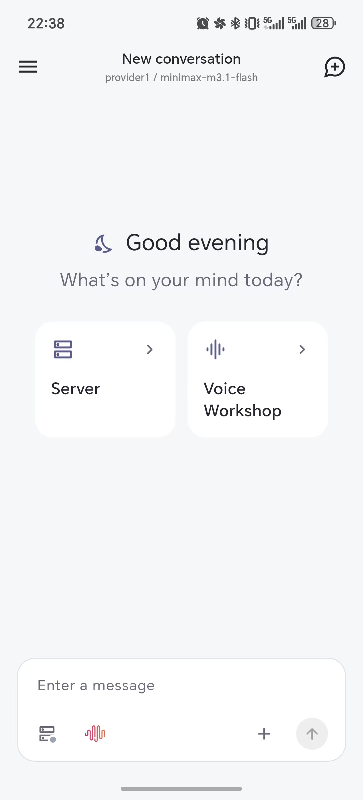
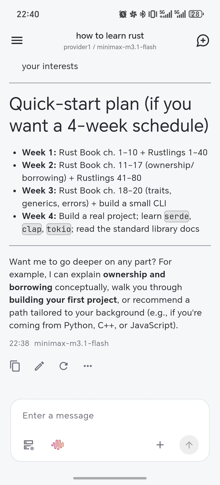
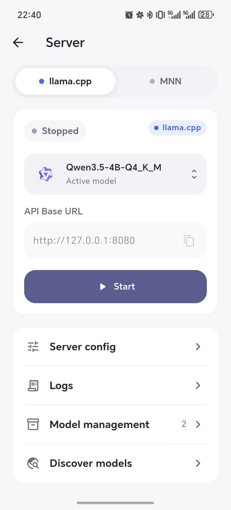
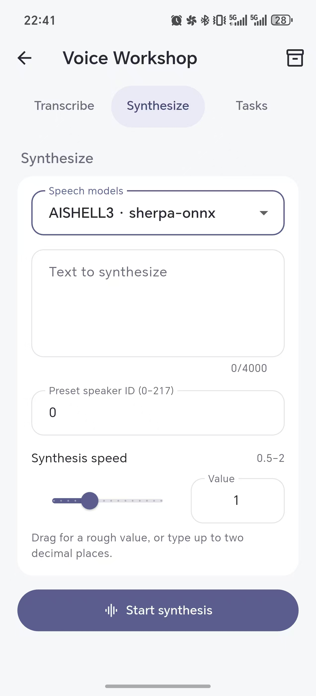
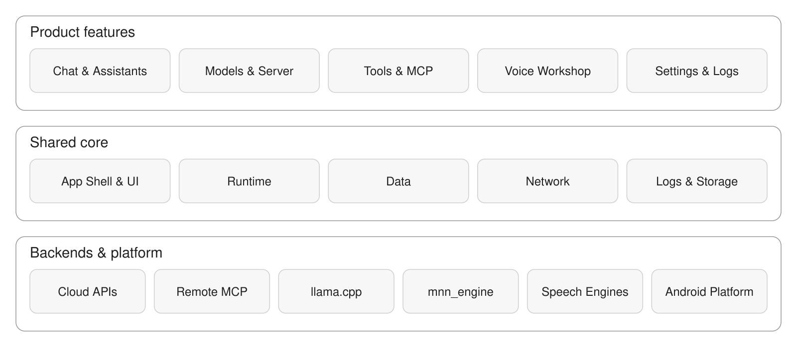

  
  <h1>ServLlama</h1>
  
<strong>An Android AI app supporting local and cloud models</strong>

  

    
  

  
<strong>English</strong> | <a href="README_ZH.md">简体中文</a>

  

    <a href="#quick-start">Quick Start</a> &middot;
    <a href="#features">Features</a> &middot;
    <a href="https://github.com/ArkaneFans/Servllama/issues">Feedback</a>
  

## Overview

ServLlama is an open-source Android AI app that integrates local models and cloud providers in one place. You can chat offline with models on your device, or connect your own API service. ServLlama can also turn your phone into an OpenAI-compatible local LLM server for other apps on the same device or local network. The Voice Workshop provides offline transcription and speech synthesis.

## Screenshots

  
  
  
  

## Download

Download the APK from [GitHub Releases](https://github.com/ArkaneFans/Servllama/releases/latest).

| Requirement | Supported |
| --- | --- |
| Platform | Android 9 (API 28) or later |
| Device architecture | 64-bit ARM (`arm64-v8a`) |
| Local models | Enough storage and memory for the models you choose |

Local LLMs and offline speech work without an internet connection after their models are installed. Cloud providers, web search, remote MCP services, and model downloads require network access. Start with a smaller local model if you are unsure what your phone can handle.

## Quick Start

After installing the app, choose a starting point below. You can use local and cloud models in the same app.

### Chat with a cloud model

1. Open **Settings → Providers**. Configure a preset provider or tap **+** to add your own service, then enter its API URL and API Key.
2. Fetch the provider's model list or add a model manually, and make sure the provider is enabled.
3. Select a model in the chat input bar and start a conversation. To keep different roles separate, create an assistant with its own instructions and model.

Cloud chat does not require starting the local server.

### Chat with a local model

1. Open **Models** from the sidebar. Use **Discover** to download a GGUF or MNN model, or tap **+** to import a local model.
2. Select the installed local model in the chat model picker. ServLlama loads it and starts the local service.
3. Start chatting. For vision-capable GGUF models, also download or import a compatible projector (`mmproj`).

### Use offline speech

1. Open **Voice Workshop** from the sidebar, then open **Speech models** and install a transcription or speech synthesis model through **Discover**.
2. Select the corresponding model. Record or import audio to transcribe it, or enter text to synthesize speech.
3. Review the result, insert a transcript into a chat draft, or export text and audio.

## Features

### Chat and Assistants

- **Local and cloud models:** support OpenAI-compatible, Anthropic, and Gemini APIs alongside on-device GGUF and MNN models.
- **Your own assistants:** give each assistant a name, instructions, model, generation settings, and enabled tools.
- **Conversation management:** streaming replies, collapsible reasoning, Markdown and code blocks, supported image input, conversation search, drafts, message editing, and reply versions.

### Local Models and Serving

- **Two inference engines:** [llama.cpp](https://github.com/ggml-org/llama.cpp) for GGUF files, and [MNN](https://github.com/alibaba/MNN) for complete MNN model directories.
- **Model discovery and downloads:** browse featured models or search Hugging Face and ModelScope; pause, resume, retry, and switch download sources.
- **Model management:** import, rename, delete, and configure installed models, including compatible vision projectors for GGUF models.
- **A server on your phone:** publish a local model to other clients, with configurable ports, loopback or LAN access, optional API-key authentication, and foreground service notifications.

### Tools, Skills, and MCP

- **Built-in tools:** web search, current time, and questions that let the model ask you for clarification.
- **Skills:** import Markdown or ZIP packages, or paste skill instructions, and enable them for an assistant. Skills provide instructions and resources; packaged scripts are not executed.
- **Remote MCP:** connect HTTP/SSE MCP servers, discover their tools, and manage which tools an assistant can use. Tool calls have visible records and approval prompts where required.

Tool use requires a model that supports tool calling. Local shell execution and stdio MCP servers are not supported.

### Offline Voice Workshop

- **Speech to text:** record or import audio, review and edit transcripts, and export TXT. Subtitle export is available when the model provides reliable timestamps.
- **Text to speech:** synthesize text locally, preview the result, and export WAV audio.
- **Chat integration:** insert transcribed text into a draft and read assistant replies aloud. Speech jobs keep their results and can run alongside a local LLM.

### Everyday Use

- **Local data:** conversations, drafts, configuration, and speech results are stored on your device; API credentials use secure storage.
- **Appearance and navigation:** light and dark themes, Chinese and English interfaces, and a sidebar for assistants, history, models, services, and settings.
- **Diagnostics:** view, filter, copy, and export application and runtime logs when troubleshooting.

## Connect Another AI Client

Open **Server**, choose the engine and model, and start the service. Use the address shown on that page when configuring another OpenAI-compatible client.

| Client setting | Value |
| --- | --- |
| API Base URL on the same phone | `http://127.0.0.1:8080/v1` with the default port |
| API Base URL on another device | `http://<phone-ip>:<port>/v1`; enable listening on all interfaces first |
| API Key | The key configured for your local server, if authentication is enabled |
| Model ID | The ID returned by `GET /v1/models` |

Both engines support `GET /v1/models` and `POST /v1/chat/completions`, including streaming replies. Additional llama-server-specific endpoints depend on the active engine. Only one local LLM runs at a time; publishing a model for other clients and choosing a chat model are separate settings.

## Architecture

  

## Usage and Privacy Notes

- **Local does not mean every feature is offline.** Cloud providers receive the conversation content you send to them; search and remote tools receive the inputs needed for their tasks. Choose services you trust.
- **Speech stays local.** Transcription does not automatically upload the original audio or send a chat message. Speech synthesis and recognition are in-app features, not endpoints of the local LLM API.
- **Protect LAN access.** Listening on all interfaces exposes your server to connected Wi-Fi, hotspot, and VPN networks. Set an API key and use a trusted network.
- **Background limits still apply.** If Android stops the service, allow notifications, background activity, and auto-start where available, and review battery optimization settings.
- **Models and devices differ.** Supported languages, vision, tools, GPU acceleration, and output quality depend on the model and device. Initial loading or GPU tuning can take time; try CPU or a higher-precision setting if output is unreliable. Downloaded models have their own licenses.

## Feedback and Contribution

Report bugs and suggestions through [GitHub Issues](https://github.com/ArkaneFans/Servllama/issues). Include your app version, phone model, Android version, model/backend, and reproduction steps. Remove API keys and private content before sharing logs.

For source development, see [AGENTS.md](AGENTS.md). Native preparation is documented in [the llama.cpp build notes](patches/llama.cpp/README.md) and [the speech build script](tool/build_speech_native.ps1); the MNN plugin is maintained in [mnn_engine](https://github.com/ArkaneFans/mnn_engine). Detailed feature and technical documents live in [docs/engineering](docs/engineering).

## Acknowledgements

- [llama.cpp](https://github.com/ggml-org/llama.cpp), [MNN](https://github.com/alibaba/MNN), and [mnn_engine](https://github.com/ArkaneFans/mnn_engine) for local LLM inference.
- [sherpa-onnx](https://github.com/k2-fsa/sherpa-onnx) and [CrispASR](https://github.com/CrispStrobe/CrispASR) for offline speech.
- [Kelivo](https://github.com/Chevey339/kelivo) and [RikkaHub](https://github.com/re-ovo/rikkahub) for inspiration in chat interaction and information organization.
- [Linux DO Community](https://linux.do/).

## License

ServLlama is released under the [GNU Affero General Public License v3.0](LICENSE). Third-party components and models retain their respective licenses.
